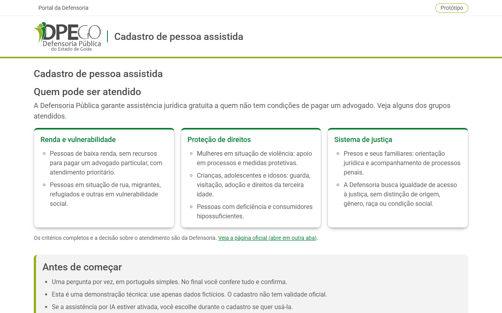
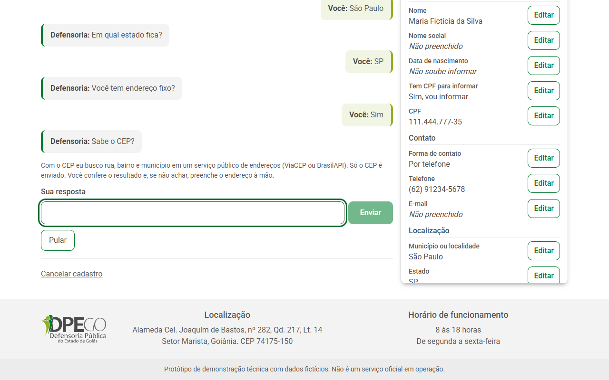
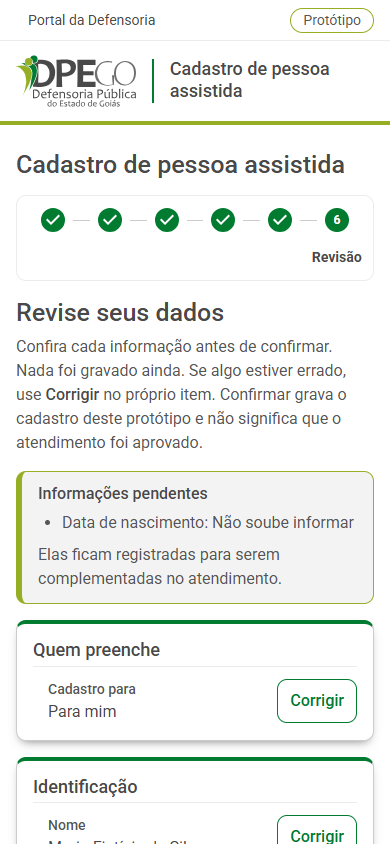
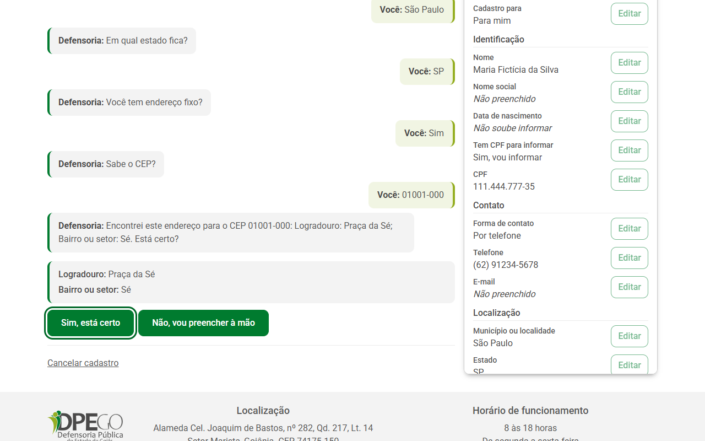
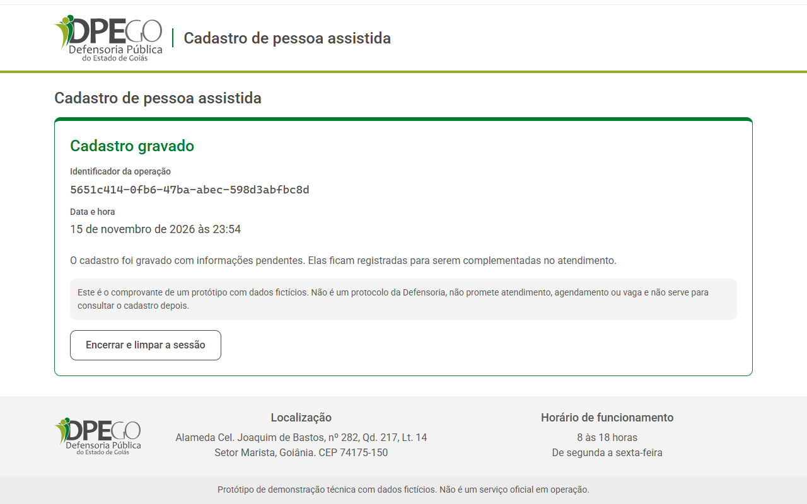

# Cadastro de pessoa assistida

Protótipo de cadastro por conversa guiada para a **Defensoria Pública do Estado de Goiás**. A pessoa responde uma pergunta por vez, confere tudo numa tela de conferência e só então confirma. O backend em Java conduz o fluxo, valida e grava. Uma IA pode ajudar a entender texto livre, mas só propõe: quem decide é o servidor, e a pessoa sempre confere.

> **Demonstração técnica com dados fictícios.** O cadastro e o comprovante não têm validade oficial, não criam atendimento nem processo e não se integram a sistemas da Defensoria. Não use dados de pessoas reais.



## O que já faz

- **Conversa conduzida pelo servidor**, com barra de etapas e painel "Suas respostas" ao lado, onde cada item pode ser editado.
- **Ausência justificada**: quem não tem ou não sabe CPF, nascimento, telefone ou número registra isso, e nada é inventado para preencher campo.
- **Validação de CPF e telefone** com máscara no formulário e as mesmas regras no servidor (dígitos verificadores, DDD existente, celular e fixo).
- **Busca de endereço por CEP** (ViaCEP, com BrasilAPI de reserva). A pessoa confere o endereço achado. Se o CEP não existe ou os serviços caem, o endereço segue manual.
- **IA opcional** (relato livre, normalização de município e ocupação, ajuda por catálogo). Se falhar, o cadastro continua por perguntas diretas.
- **Tela de conferência** própria: cartões por seção, ausências com selo, **Corrigir** por item e o único botão que grava.
- **Gravação segura**: confirmação idempotente, transação única, duplicidade de CPF sem revelar terceiros.
- **Privacidade por padrão**: sessão privada, sem listagem nem busca, limites de uso e segredos só no servidor.

| Durante a conversa | Conferência |
|---|---|
|  |  |

| Endereço pelo CEP | Comprovante |
|---|---|
|  |  |

A tela de conferência completa está em [docs/img/04-conferencia.png](docs/img/04-conferencia.png).

## Como rodar

### Com Docker (recomendado)

Requer Docker com Compose.

```bash
cp .env.example .env
docker compose up --build
```

- Interface: http://localhost:8080 · API: http://localhost:8081
- As portas ficam só em `127.0.0.1` e mudam no `.env` (`WEB_PORT`, `API_PORT`, `DB_PORT`).
- Sem `LLM_API_KEY` o cadastro funciona por perguntas diretas e a tela avisa que a IA não está configurada.

Para parar e apagar os dados de demonstração deste projeto:

```bash
docker compose down -v
```

### Execução local

Requer JDK 21, Node 22 ou superior e Docker (para o PostgreSQL).

```bash
docker compose up -d db
```

```bash
cd backend && ./mvnw spring-boot:run
```

```bash
cd frontend && npm install && npm run dev
```

A interface fica em http://localhost:5173 e o Vite encaminha `/api` para a API. No PowerShell use `.\mvnw.cmd`. Em HTTPS defina `SESSAO_COOKIE_SEGURO=true`.

## Variáveis de ambiente

Copie `.env.example` para `.env`. O `.env` está no `.gitignore` e **nunca** deve ser versionado.

| Variável | Padrão | Função |
|---|---|---|
| `WEB_PORT`, `API_PORT`, `DB_PORT` | 8080, 8081, 5433 | Portas publicadas em `127.0.0.1` |
| `DB_NAME`, `DB_USER`, `DB_PASSWORD` | cadastro, cadastro, (vazio) | Banco. Vazio usa uma senha padrão só do banco local de demonstração |
| `SESSAO_EXPIRACAO_MINUTOS` | 30 | Inatividade até expirar a sessão |
| `SESSAO_COOKIE_SEGURO` | false | `true` atrás de HTTPS |
| `CORS_ORIGENS` | (vazio) | Origens extras. Vazio aceita só a mesma origem |
| `LIMITE_RESPOSTAS_POR_SESSAO`, `LIMITE_RESPOSTAS_POR_MINUTO`, `LIMITE_REQUISICOES_POR_ORIGEM_POR_MINUTO` | 60, 10, 120 | Limites de uso |
| `LLM_API_KEY` | (vazio) | Chave do provedor de IA. **Só no backend** |
| `LLM_BASE_URL`, `LLM_MODEL` | Mistral | Qualquer API compatível com Chat Completions |
| `LLM_TIMEOUT_SECONDS`, `LLM_MAX_OUTPUT_TOKENS` | 15, 350 | Limites da chamada de IA |
| `CEP_TIMEOUT_MS` | 3000 | Limite da consulta de CEP |
| `SPRING_PROFILES_ACTIVE` | (vazio) | `prod` faz a API recusar-se a subir sem `SESSAO_COOKIE_SEGURO=true` e `DB_PASSWORD` próprios |

## Testes

```bash
cd backend && ./mvnw verify
```

```bash
cd frontend && npm run lint && npm test && npm run build
```

O backend usa PostgreSQL real em contêiner (precisa de Docker), e os provedores externos são simulados. O frontend usa Vitest, Testing Library e axe-core. Detalhes em [docs/testes.md](docs/testes.md).

## Limitações

- **Não é produção.** Não há verificação de identidade: um CPF válido não comprova titularidade. Não há painel interno nem como recuperar ou alterar um cadastro gravado.
- **Representação** de outra pessoa é só declarada, sem conferir vínculo ou documentos.
- **Serviços externos** (IA e CEP) não tiveram contrato, retenção e base legal avaliados. Planos gratuitos podem usar as entradas para treinamento.
- **Limites de uso em memória**, válidos para uma instância. Os números são hipóteses, não capacidade medida.
- **Sem upload ou conferência de documentos** nem checklist de documentos.
- **Recarregar a página** perde a conversa: o estado não é guardado no navegador.
- Corrigir o CEP depois não refaz a busca do endereço.

## Documentação

Tudo o que o código faz está descrito em [docs/](docs/README.md):

| | |
|---|---|
| [Tecnologias](docs/tecnologias.md) | [Arquitetura](docs/arquitetura.md) |
| [Regras de negócio (RF01 a RF18)](docs/regras-de-negocio.md) | [Modelo de dados](docs/modelo-de-dados.md) |
| [API](docs/api.md) | [Integração com IA](docs/integracao-ia.md) |
| [Integrações externas (CEP)](docs/integracoes-externas.md) | [Privacidade e segurança](docs/privacidade-e-seguranca.md) |
| [Testes](docs/testes.md) | [Decisões](docs/decisoes.md) |

O frontend segue a identidade do portal da Defensoria (https://www2.defensoria.go.def.br/): marca oficial, verdes `#007B2F` e `#95AE23`, cinza `#565656` e fonte Roboto.
