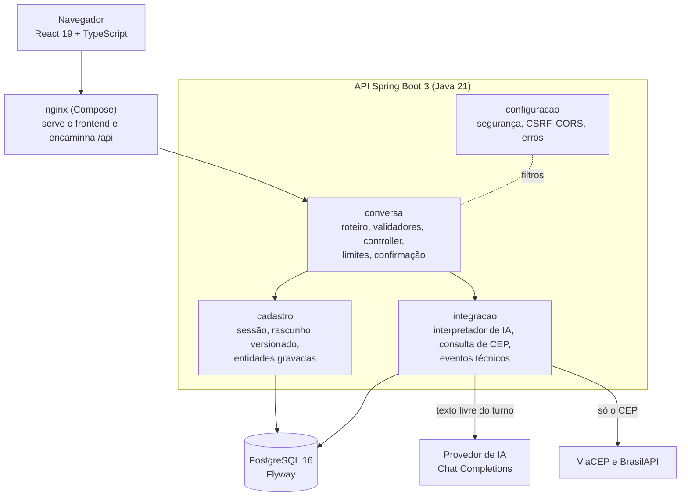
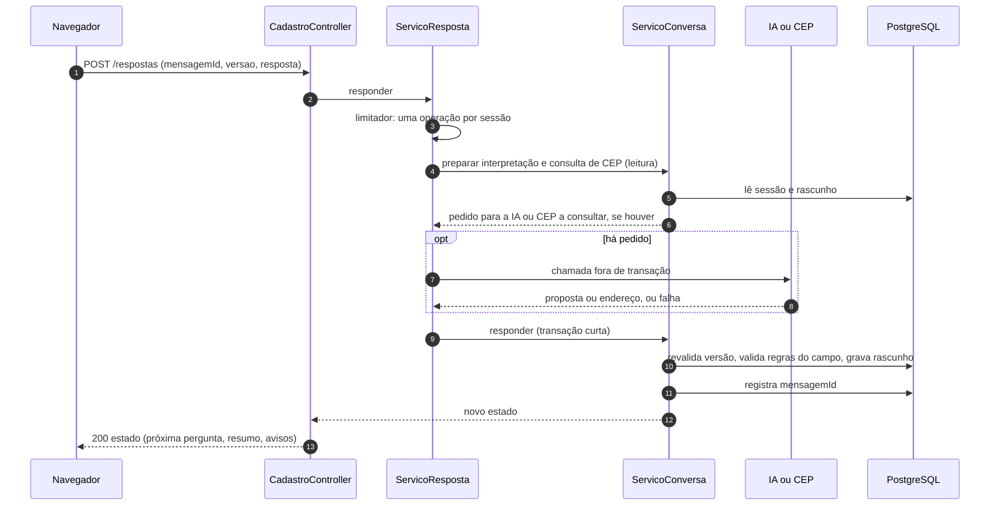

# Arquitetura

Monólito modular: uma API Spring Boot, um frontend estático e um banco. Não há fila, cache externo nem serviço de autenticação.

## Módulos do backend

| Pacote | Responsabilidade | Classes principais |
|---|---|---|
| `cadastro` | Sessão privada, rascunho versionado e entidades gravadas | `SessaoCadastro`, `RascunhoCadastro`, `ServicoSessao`, `PessoaCadastro`, `DeclaracaoSocioeconomica`, `Campo`, `MotivoAusencia` |
| `conversa` | Fluxo de perguntas, regras de cada campo, API REST, limites e confirmação | `RoteiroCadastro`, `Pergunta`, `Validadores`, `ServicoConversa`, `ServicoResposta`, `ServicoConfirmacao`, `MontadorEstado`, `CadastroController`, `LimitadorRequisicoes` |
| `integracao` | Tudo o que sai do servidor, mais eventos técnicos | `InterpretadorChatCompletions`, `ValidadorSaida`, `ServicoInterpretacao`, `ServicoCep`, `ClienteViaCep`, `ClienteBrasilApi`, `ServicoEventos` |
| `configuracao` | Segurança e erros | `ConfiguracaoSeguranca`, `FiltroLimitePorOrigem`, `TratadorErros` |

`conversa` usa `cadastro` e `integracao`. Nenhum dos dois usa `conversa`.

## O servidor conduz a conversa

O roteiro é uma lista declarativa de `Pergunta` em `RoteiroCadastro`. Cada pergunta tem campo, seção, tipo de entrada, validador, alternativas (incluindo as de ausência) e uma condição de aplicação. **A etapa atual não é guardada**: a próxima pergunta é sempre a primeira pergunta aplicável que ainda não foi respondida. Por isso o fluxo continua coerente depois de uma correção que muda a aplicabilidade de outras perguntas.

O frontend não conhece o roteiro. Ele recebe, a cada resposta, o estado completo (`EstadoConversa`): a próxima pergunta com o tipo de entrada, as opções, o resumo por seção, as pendências e os avisos.

## Um turno de resposta

Pontos que importam:

- **Chamada externa fora de transação.** `ServicoResposta` consulta a IA e o CEP entre duas transações curtas (leitura e gravação), para não segurar conexão do banco enquanto espera um terceiro.
- **A versão é revalidada na gravação.** Se o estado mudou durante a espera, o turno é recusado com `409 VERSAO_DESATUALIZADA` e a tela recarrega o estado atual.
- **Nada externo decide.** A saída da IA e o endereço do CEP são propostas. Cada valor passa de novo pelas regras do campo e, quando há dúvida, volta para a pessoa confirmar.

## Concorrência e idempotência

| Mecanismo | Onde | Efeito |
|---|---|---|
| `versao` do rascunho e da sessão, com bloqueio otimista do JPA | `rascunho_cadastro`, `sessao_cadastro` | Duas telas ou duas abas não sobrescrevem uma à outra |
| `mensagemId` por sessão (`mensagem_processada`) | `POST /respostas` | Reenvio da mesma mensagem devolve o estado atual sem reaplicar nem consultar de novo IA ou CEP |
| Uma operação de resposta por vez por sessão | `LimitadorRequisicoes.iniciarResposta` | Segunda chamada simultânea recebe `429` com "Aguarde a resposta anterior terminar" |
| Bloqueio pessimista da linha da sessão | `ServicoConfirmacao.confirmar` | Duas confirmações simultâneas gravam um único cadastro |
| `confirmacao_cadastro.sessao_id` único e `chave_idempotencia` única | Confirmação | Repetir a confirmação devolve o mesmo comprovante |
| Índice único parcial em `pessoa_cadastro.cpf` | Confirmação | Cobre a corrida entre sessões diferentes com o mesmo CPF |

## Sessão e segurança em uma linha

Cookie `sessao_cadastro` com segredo aleatório de 256 bits (`HttpOnly`, `SameSite=Strict`, caminho `/api`), com só o hash SHA-256 no banco, e token CSRF em cookie legível pelo JavaScript. Detalhes em [privacidade-e-seguranca.md](privacidade-e-seguranca.md).

## Frontend

`Cadastro.tsx` decide qual tela mostrar a partir do estado devolvido pelo servidor:

| Situação | Tela |
|---|---|
| Sem sessão | `PaginaInicial` |
| Preenchimento ou esclarecimento | `EtapasProgresso` + `ChatCadastro` + `PainelRespostas` |
| `EM_REVISAO` | `TelaConferencia`, em tela cheia e fora da conversa |
| `CONFIRMADO` | `ComprovanteCadastro` |
| Sessão encerrada ou expirada | `ChatCadastro` com o aviso e o botão de novo cadastro |

`useConversa` mantém uma operação por vez, reaproveita o `mensagemId` em nova tentativa após falha de rede e usa uma chave de idempotência por versão revisada na confirmação. `EntradaConversa` escolhe a entrada pelo `tipoEntrada` recebido e aplica máscara e validação de CPF e telefone antes de enviar. O servidor valida de novo.
