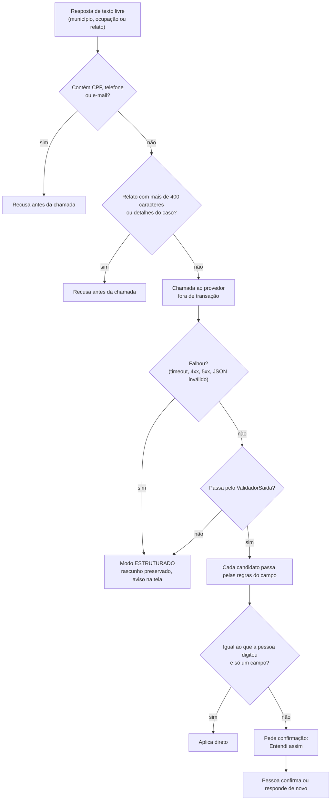

# Integração com IA

A IA é um **interpretador de respostas**, não o controlador da aplicação. Ela só propõe valores. Quem valida, decide a próxima pergunta, exige a revisão e grava é o Java.

## Quando ela entra

- A assistência só é oferecida se `LLM_API_KEY` está configurada. Sem chave, a pergunta `avisoIa` nem aparece, a tela informa que a IA não está configurada e o cadastro segue por perguntas diretas.
- Com chave, a pessoa escolhe **Usar assistência por IA** ou **Continuar com perguntas estruturadas**. O aviso diz o que será enviado a um serviço externo.
- Só então a sessão passa ao modo `ASSISTIDO_POR_IA`.

## O que a IA faz de visível

| Recurso | Como funciona |
|---|---|
| **Relato livre** | Depois de aceitar a IA, a pessoa pode contar em até 400 caracteres onde mora, o que faz e quem mora com ela. A IA propõe município, UF, ocupação, renda, pessoas na casa, dependentes e moradia. A pessoa confere a lista "Entendi assim" e as perguntas já cobertas são puladas. O texto do relato não é guardado: fica só o marcador `ENVIADO` |
| **Normalização** | Em município e ocupação, corrige grafia ("goiania" vira "Goiânia") e sugere a UF só quando é inequívoca ou a pessoa disse o estado |
| **Ajuda por catálogo** | Quando uma resposta é recusada e parece uma dúvida, o servidor pergunta à IA qual verbete do catálogo responde. O modelo devolve só o **id**. O texto exibido é sempre escrito localmente (`AjudaCatalogo`) |

O catálogo local tem 11 verbetes: `nome-social`, `por-que-cpf`, `documento-ausente`, `ocupacao`, `renda-mensal`, `nucleo-familiar`, `dependentes`, `moradia`, `endereco-fixo`, `contato-referencia` e `finalidade-cadastro`. Os verbetes não aconselham juridicamente nem prometem atendimento.

## O que vai ao modelo e o que não vai

**Vai:** o texto livre do turno (relato, município ou ocupação, ou a dúvida), a pergunta atual, os campos permitidos naquele turno (com as opções fechadas de moradia e estado) e os títulos do catálogo de ajuda.

**Nunca vai:** nome, CPF, nascimento, telefone, e-mail, CEP, endereço detalhado, histórico da conversa, dados de sessão.

Antes da chamada o servidor recusa o texto, sem enviá-lo, se:

| Filtro | Efeito |
|---|---|
| Contém CPF, telefone ou e-mail (`ContemDadosPessoais`) | Pede que o dado vá no campo próprio |
| Relato com mais de 400 caracteres | Recusa |
| Relato com termos de detalhe do caso, como violência, saúde, religião ou processos (`ConteudoSensivel`) | Pede só os dados pedidos |

Os filtros reduzem a exposição, mas **não garantem anonimização**.

## Contrato

Requisição: `POST {LLM_BASE_URL}/chat/completions`, com `Authorization: Bearer`, `temperature` 0, `response_format` `json_object`, `max_tokens` igual a `LLM_MAX_OUTPUT_TOKENS` (padrão 350) e um prompt curto que descreve as regras.

Saída esperada:

```json
{
  "operacao": "PROPOR_VALORES",
  "candidatos": [
    { "campo": "municipio", "valor": "Goiânia", "trechoOrigem": "goiania" }
  ],
  "precisaEsclarecimento": false,
  "topico": null
}
```

| Operação | Significado |
|---|---|
| `PROPOR_VALORES` | Valores propostos para campos da lista do turno |
| `SOLICITAR_ESCLARECIMENTO` | A resposta é ambígua |
| `AJUDA` | Extensão do contrato original da ata: devolve só o id de um verbete do catálogo enviado |
| `FORA_DE_ESCOPO` | A resposta não trata da pergunta |

O `valor` é sempre texto entre aspas, inclusive para números.

## Validação da saída

O JSON é lido de forma estrita (propriedades desconhecidas e tipos incompatíveis falham) e depois passa por `ValidadorSaida`. **Qualquer** violação descarta a resposta inteira, sem aplicar valor parcial:

| Regra |
|---|
| Propriedades obrigatórias presentes |
| `FORA_DE_ESCOPO` e `AJUDA` sem candidatos |
| `topico` só em `AJUDA`, e só um id do catálogo enviado |
| Campo dentro da lista do turno e sem repetição |
| Valor não vazio, curto e sem caractere de controle |
| Campo de escolha fechada: valor igual a um dos ids oferecidos |
| `trechoOrigem` que **existe de fato** no texto da pessoa |

Operações como confirmar, gravar ou saltar etapas não existem no contrato e são rejeitadas. O motivo da recusa é registrado no log pelo **nome da regra**, nunca com o texto da pessoa nem o conteúdo da resposta do modelo.

## O que acontece com a proposta



- Cada candidato passa de novo pelas regras do campo. Os candidatos são validados na ordem do roteiro e sobre uma cópia do rascunho, de modo que um valida o seguinte (por exemplo, dependentes menor que o total de pessoas).
- Nada sobrescreve uma resposta existente.
- O valor só é aplicado direto quando é igual ao que a pessoa digitou (sem considerar acento e caixa) e é um único campo. Qualquer ajuste do modelo, UF sugerida ou mais de um dado vai para a confirmação.
- Se a resposta recusada pelo campo era uma dúvida e a IA aponta um verbete válido, o aviso `Ajuda: …` aparece e a pergunta é repetida sem mudar o rascunho.

## Falhas

Nenhuma falha é repetida automaticamente. O modo passa a `ESTRUTURADO`, o rascunho é preservado e a tela avisa que a assistência está indisponível. Nada é simulado como resposta do modelo.

| Situação | Categoria interna |
|---|---|
| Sem chave | `SEM_CHAVE` |
| HTTP 401 ou 403 | `NAO_AUTORIZADO` |
| HTTP 402 | `SEM_CREDITO` |
| HTTP 429 | `LIMITE_EXCEDIDO` |
| Timeout | `TEMPO_ESGOTADO` |
| HTTP 5xx | `ERRO_SERVIDOR` |
| JSON inválido, truncado, campo inventado ou fora da lista | `RESPOSTA_INVALIDA` |
| Outro erro de rede ou HTTP | `INDISPONIVEL` |

Cada chamada gera um evento técnico `INFERENCIA` com o status e a duração, sem conteúdo.

## Provedores

`InterpretadorRespostas` é a interface e `InterpretadorChatCompletions` serve qualquer API compatível com Chat Completions (autenticação Bearer e `response_format` JSON). Trocar de provedor é mudar `LLM_BASE_URL`, `LLM_MODEL` e `LLM_API_KEY`.

| Provedor | `LLM_BASE_URL` | `LLM_MODEL` | Situação |
|---|---|---|---|
| Mistral (padrão) | `https://api.mistral.ai/v1` | `mistral-small-latest` | Padrão do projeto, mesmo contrato |
| Google Gemini | `https://generativelanguage.googleapis.com/v1beta/openai` | `gemini-2.5-flash-lite` | Chamada real validada, com resposta em cerca de 1 a 2 segundos |

Prefira modelos sem raciocínio estendido: eles gastam os 350 tokens de saída pensando e a resposta cortada é descartada. Os nomes de modelo mudam com o tempo, então confira a lista do provedor.

Variáveis: `LLM_API_KEY`, `LLM_BASE_URL`, `LLM_MODEL`, `LLM_TIMEOUT_SECONDS` (15), `LLM_MAX_OUTPUT_TOKENS` (350).

## Segredo

A chave existe só no processo da API. Não há variável `VITE_` com segredo, e ela não aparece no pacote do frontend, nas respostas, nos logs nem na representação textual da configuração (`PropriedadesLlm.toString` mostra `***`). Há teste para cada ponto.

## Limitações

- Antes de qualquer uso real é preciso avaliar finalidade, contrato, retenção e localização do processamento. Planos gratuitos podem usar as entradas para treinamento, e endpoints `http` trafegam a chave e o texto sem criptografia. Use só dados fictícios.
- A integração foi validada com servidor simulado e com chamadas reais (`InterpretadorRealTest`, que só roda com chave no ambiente).
- A latência depende do provedor. Provedores locais ou lentos podem estourar o limite de 15 segundos na primeira chamada, e o cadastro simplesmente segue por perguntas diretas.
