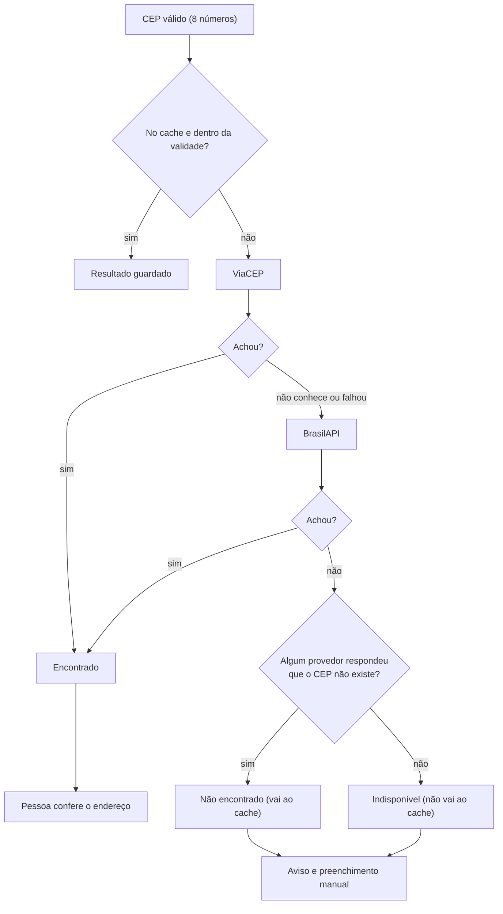

# Integrações externas: busca de endereço por CEP

Além do provedor de IA (ver [integracao-ia.md](integracao-ia.md)), o sistema consulta serviços públicos de CEP. O CEP é opcional, e a consulta nunca bloqueia o cadastro.

## Princípios

- **Só o backend consulta.** O navegador nunca fala com ViaCEP nem BrasilAPI.
- **Só o CEP sai.** Nenhum outro dado pessoal vai na URL, em cabeçalho ou no corpo. A pergunta explica isso à pessoa.
- **Quem confirma é a pessoa.** O endereço achado é uma proposta. Nada é preenchido antes da confirmação.
- **Nada é inventado.** CEP inexistente ou serviços fora do ar levam ao preenchimento manual.

## Provedores

| Ordem | Serviço | URL consultada |
|---|---|---|
| 1º | ViaCEP | `https://viacep.com.br/ws/{cep}/json/` |
| 2º (reserva) | BrasilAPI | `https://brasilapi.com.br/api/cep/v2/{cep}` |

`{cep}` são os 8 números, sem máscara. As URLs base são configuráveis (`CEP_VIACEP_URL`, `CEP_BRASILAPI_URL`), o que permite apontar para um servidor simulado nos testes.

O ViaCEP responde `200` com `{"erro": ...}` para CEP inexistente, e a BrasilAPI responde `404`. Os dois casos, e também `400`, contam como "o provedor não conhece este CEP".

## Lógica de consulta

| Item | Valor |
|---|---|
| Timeout por provedor | 3 segundos (`CEP_TIMEOUT_MS`), de conexão e de leitura |
| Falhas que levam ao próximo provedor | Timeout, erro de rede, HTTP 5xx ou 429, JSON inválido, resposta sem município ou UF válidos |
| Cache | Em memória, até 500 CEPs (`CEP_CACHE_MAXIMO`) por 6 horas (`CEP_CACHE_VALIDADE_HORAS`). Descarta o menos usado. Guarda "encontrado" e "não encontrado", nunca "indisponível" |
| Limpeza do que o provedor devolve | Remove caractere de controle, espaços repetidos e limita a 200 caracteres. A UF precisa ter duas letras |

Em CEP de município pequeno, logradouro e bairro podem vir vazios. Isso é aceito, e as duas perguntas são feitas manualmente.

## No fluxo da conversa

A pergunta de CEP vem logo depois de "tem endereço fixo". A consulta acontece em `ServicoResposta`, fora de transação, no mesmo padrão da IA.

| Resultado | O que a pessoa vê |
|---|---|
| Encontrado e coerente com o município informado | "Encontrei este endereço para o CEP …: Logradouro: …; Bairro: …. Está certo?", com os itens listados. **Sim** preenche CEP, logradouro e bairro. **Não** deixa o CEP como não preenchido e segue manual |
| Encontrado, mas município ou UF diferem do informado | "O CEP … é de Goiânia, GO, diferente do que você informou (Anápolis, GO). Qual vale?" **Usar o endereço do CEP** troca município e UF e preenche o resto. **Manter o que informei** mantém tudo e o CEP fica como não preenchido |
| Não encontrado | Aviso "Não encontrei esse CEP nas bases consultadas". O CEP digitado fica registrado e o endereço segue manual |
| Serviços fora do ar | Aviso "Não consegui consultar o CEP agora". O CEP digitado fica registrado e o endereço segue manual |
| CEP inválido ou pulado | Nenhuma consulta |

A comparação de município ignora acento e caixa ("goiania" é igual a "Goiânia"). Cada valor vindo do provedor passa pelas mesmas regras do campo antes de ser proposto. Depois da confirmação ficam só número e complemento.

## Eventos técnicos

Cada consulta gera um evento `CONSULTA_CEP` com o status (`ENCONTRADO`, `NAO_ENCONTRADO`, `INDISPONIVEL` ou `CACHE`), o provedor que respondeu e a duração. **O CEP não aparece** em evento nem em log. Uma falha de provedor registra só o nome do provedor e o motivo técnico.

## Configuração

| Variável | Padrão |
|---|---|
| `CEP_TIMEOUT_MS` | 3000 |
| `CEP_VIACEP_URL` | `https://viacep.com.br/ws` |
| `CEP_BRASILAPI_URL` | `https://brasilapi.com.br/api/cep/v2` |
| `CEP_CACHE_MAXIMO` | 500 |
| `CEP_CACHE_VALIDADE_HORAS` | 6 |

No Compose só `CEP_TIMEOUT_MS` é repassado. As demais valem para execução local.

## Limitações

- Depende da disponibilidade e das regras de uso de serviços públicos de terceiros, sem acordo de nível de serviço. Antes de uso real convém avaliar volume, termos e a opção de uma base própria.
- O cache é por instância e não sobrevive a reinício.
- **Corrigir o CEP depois**, pelo painel ou pela conferência, grava o novo CEP sem refazer a busca e sem mudar logradouro, bairro, município ou UF.
- O CEP é um dado pessoal indireto e vai a terceiros. Isso é declarado na pergunta, mas a base legal e o contrato com os provedores não foram avaliados.
