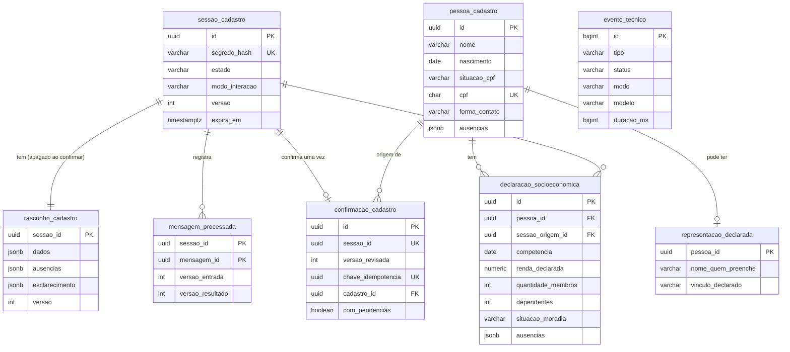

# Modelo de dados

Esquema em `backend/src/main/resources/db/migration` (Flyway). O Hibernate só valida (`ddl-auto: validate`): quem cria as tabelas são as migrações.

| Migração | Conteúdo |
|---|---|
| `V1__sessao_e_rascunho.sql` | `sessao_cadastro`, `rascunho_cadastro`, `mensagem_processada` |
| `V2__cadastro_confirmado.sql` | `pessoa_cadastro`, `representacao_declarada`, `declaracao_socioeconomica`, `confirmacao_cadastro` |
| `V3__evento_tecnico.sql` | `evento_tecnico` |
| `V4__esclarecimento_pendente.sql` | Coluna `esclarecimento` em `rascunho_cadastro` |

O diagrama mostra só as colunas principais. A lista completa está nas migrações.

## Temporário e definitivo

| Grupo | Tabelas | Vida |
|---|---|---|
| Temporário | `sessao_cadastro`, `rascunho_cadastro`, `mensagem_processada` | Até a confirmação, o cancelamento ou a expiração. O rascunho é apagado ao confirmar. Sessões encerradas são removidas depois do prazo de retenção (24 h por padrão) pela rotina de limpeza, que roda a cada 5 minutos |
| Definitivo | `pessoa_cadastro`, `representacao_declarada`, `declaracao_socioeconomica`, `confirmacao_cadastro` | Gravados juntos, na mesma transação. `DELETE /sessao` não os apaga |
| Técnico | `evento_tecnico` | Só metadados, sem dado pessoal |

## O rascunho

`rascunho_cadastro` guarda três colunas `JSONB`:

| Coluna | Conteúdo |
|---|---|
| `dados` | Mapa do id do campo para o valor aceito, já normalizado (CPF só com números, data em ISO, renda com duas casas) |
| `ausencias` | Mapa do id do campo para o motivo da ausência |
| `esclarecimento` | A alteração proposta que espera a escolha da pessoa, ou nulo |

O texto do relato livre **nunca** é guardado. No lugar fica só o marcador `ENVIADO`. `mensagem_processada` guarda apenas os ids e as versões, sem o texto da mensagem.

## Restrições que protegem os dados

| Tabela | Restrição |
|---|---|
| `sessao_cadastro` | `segredo_hash` único. `estado` e `modo_interacao` limitados aos valores válidos |
| `pessoa_cadastro` | Nome não vazio. `situacao_cpf` limitada a `INFORMADO`, `NAO_POSSUI`, `DESCONHECIDO` e `NAO_APRESENTADO`. CPF com 11 dígitos. `cpf` preenchido **se e só se** a situação é `INFORMADO`. Índice único parcial em `cpf` onde não é nulo |
| `declaracao_socioeconomica` | Renda maior ou igual a zero (`NUMERIC(15,2)`), ao menos um membro, dependentes maiores ou iguais a zero e **menores** que o número de membros, moradia limitada a seis valores |
| `confirmacao_cadastro` | `sessao_id` único e `chave_idempotencia` única |

As regras importantes valem no banco e não só no código, de modo que um erro de aplicação não grave dado incoerente.

## O que é o retrato socioeconômico

`declaracao_socioeconomica` é um retrato datado: tem `competencia` (primeiro dia do mês da confirmação, no fuso de Brasília) e `coletada_em`, e referencia a sessão de origem. Uma pessoa pode ter mais de uma declaração, embora o protótipo grave só uma por cadastro.

## Eventos técnicos

`evento_tecnico` registra `tipo`, `status`, `modo`, `modelo`, `duracao_ms` e um id de correlação. Os tipos hoje são:

| Tipo | Status | Campo `modelo` |
|---|---|---|
| `INFERENCIA` | `SUCESSO` ou a categoria da falha | Nome do modelo de IA |
| `CONSULTA_CEP` | `ENCONTRADO`, `NAO_ENCONTRADO`, `INDISPONIVEL` ou `CACHE` | Provedor que respondeu (`viacep`, `brasilapi`, `provedores` ou `cache`) |
| `CONFIRMACAO` | `SUCESSO` ou `CONFLITO_CADASTRAL` | Nulo |

Nenhum evento carrega CPF, CEP, texto da pessoa, chave ou conteúdo da conversa.
