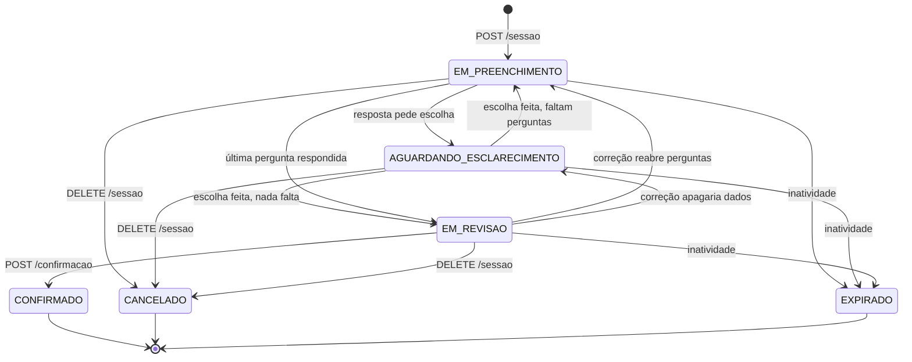

# Regras de negócio

Os códigos RF01 a RF18 são os da ata de requisitos do desafio. A tabela diz como cada um foi atendido e onde está a prova nos testes.

## Requisitos funcionais

| Código | Requisito | Como foi atendido | Testes |
|---|---|---|---|
| RF01 | Iniciar por conversa, sem lista de pessoas; página inicial com apresentação e **Começar** | `PaginaInicial` explica quem pode ser atendido e cria a sessão com `POST /sessao`. Não existe rota de listagem ou busca | `PaginaInicial.test`, `SessaoPrivadaTest` |
| RF02 | Conduzir etapas no Java | `RoteiroCadastro` decide a próxima pergunta. A interface só mostra o que recebe | `RoteiroCadastroTest`, `ServicoConversaTest` |
| RF03 | Aceitar ausência justificada, sem inventar valor | Respostas de ausência gravam `NULL` com o motivo (ver [Ausências](#ausências)) | `ConfirmacaoTest`, `PersistenciaCadastroTest` |
| RF04 | Interpretar texto livre com IA só quando necessário; identificadores e escolhas fechadas ficam diretos | A IA só atua em município, ocupação e relato. CPF, nascimento, telefone, e-mail, CEP e escolhas nunca vão ao modelo | `AssistenciaIaTest`, `AssistenciaIaRelatoTest` |
| RF05 | Validar entrada e saída no servidor; campos extras ou instruções do modelo não viram operação | `Validadores` para cada campo e `ValidadorSaida` mais Jackson estrito para a saída da IA | `ValidadoresTest`, `InterpretadorChatCompletionsTest` |
| RF06 | Corrigir dado já informado, preservando os demais e gerando nova versão | `PATCH /campos/{campo}`. Se a correção invalida outras respostas, pede confirmação antes de apagá-las | `CadastroApiTest`, `ConfirmacaoTest` |
| RF07 | Revisar antes de confirmar; mudança posterior exige confirmar a nova versão | Estado `EM_REVISAO` e `TelaConferencia`. A confirmação cita a `versaoRevisada` e é recusada se o rascunho mudou | `ConfirmacaoTest`, `TelaConferencia.test` |
| RF08 | Confirmar de forma explícita e idempotente; a IA não grava | Só `POST /confirmacao` grava, com `chaveIdempotencia`. Repetir devolve o mesmo comprovante | `ConfirmacaoTest` |
| RF09 | Persistir só após a transação; falha não pode mostrar comprovante | Pessoa, declaração e confirmação na mesma transação. O evento de sucesso é registrado depois do commit | `FalhaNaTransacaoTest` |
| RF10 | Tratar duplicidade sem expor cadastro anterior | Conflito de CPF devolve `409` com orientação genérica e nada é gravado | `ConfirmacaoTest`, `PersistenciaCadastroTest` |
| RF11 | Sigilo da sessão: conhecer um id ou CPF não dá acesso | Nenhuma rota recebe identificador de cadastro. O acesso vem só do cookie | `IsolamentoEntreSessoesTest`, `SessaoPrivadaTest` |
| RF12 | Continuar sem IA em falha de integração, informando o modo e preservando respostas | A falha troca o modo para `ESTRUTURADO`, avisa na tela e mantém o rascunho | `AssistenciaIaTest` |
| RF13 | Encerrar ou expirar a sessão; rascunho some | `DELETE /sessao`, expiração por inatividade (30 min por padrão) e rotina de limpeza | `EstadoSessaoTest`, `SessaoPrivadaTest` |
| RF14 | Proteger a credencial | A chave existe só no processo da API. Não aparece no pacote do frontend, nas respostas, nos logs nem em `toString` | `SegredoForaDoNavegadorTest`, `PropriedadesLlmTest`, `LogsSemDadosPessoaisTest` |
| RF15 | Não decidir assistência, renda elegível, prazo ou aconselhamento | Não há cálculo de elegibilidade. A IA pode responder só com `AJUDA` (id de um verbete escrito localmente) ou recusar com `FORA_DE_ESCOPO`. O comprovante diz que não é protocolo | `AjudaCatalogoTest`, `AssistenciaIaTest` |
| RF16 | Limitar custo e abuso no backend | Limites por sessão, por minuto e por origem, uma resposta por vez por sessão, saída da IA limitada e timeouts | `LimitesRespostasTest`, `LimitePorOrigemTest`, `OperacaoUnicaPorSessaoTest` |
| RF17 | Situação socioeconômica resumida, com competência e ausências explícitas, sem elegibilidade | Tabela `declaracao_socioeconomica`, com competência (primeiro dia do mês da confirmação) e ausências por campo | `PersistenciaCadastroTest`, `ConfirmacaoTest` |
| RF18 | Identidade visual da Defensoria | Tokens de cor e fonte do portal em `tema/tokens.css`. Teste impede cor solta nos estilos | `Tema.test` |

### Diferença em relação à ata

A ata propõe até 1.000 caracteres por mensagem livre. O relato livre aceita no máximo **400**, e os demais textos livres respeitam o limite de cada campo (por exemplo 120 para município). É uma escolha de minimização de dados.

## Estados da sessão

`ESTRUTURADO` e `ASSISTIDO_POR_IA` são **modos de coleta**, não estados. Uma falha da IA troca o modo sem mexer no estado nem no rascunho.

O estado `AGUARDANDO_ESCLARECIMENTO` guarda uma alteração proposta, ainda não aplicada, que espera a escolha da pessoa. Há três tipos (`Esclarecimento.Tipo`):

| Tipo | Quando aparece | Efeito de "sim" | Efeito de "não" |
|---|---|---|---|
| `CONFIRMAR_LIMPEZA` | Uma correção tornaria outras respostas inválidas | Aplica a correção e apaga as respostas afetadas | Mantém tudo como está |
| `CONFIRMAR_INTERPRETACAO` | A IA propôs valores diferentes do que foi digitado, ou mais de um campo | Grava os valores propostos | Descarta a proposta e pergunta de novo |
| `CONFIRMAR_ENDERECO` | O CEP foi encontrado | Grava CEP, logradouro e bairro (e município e UF se divergirem e a pessoa preferir o CEP) | O CEP fica como não preenchido e o endereço segue manual |

## Ausências

Nada é inventado para preencher campo. Quando a pessoa declara que não tem ou não sabe, o valor fica `NULL` e o motivo é registrado (`MotivoAusencia`):

| Motivo | Exemplos de resposta |
|---|---|
| `NAO_POSSUI` | "Não possuo CPF", "Não tenho telefone" |
| `DESCONHECIDO` | "Não sei informar" |
| `NAO_APRESENTADO` | "Não estou com o documento" |
| `INDISPONIVEL` | "Não há contato disponível agora", "Não tenho referência" |
| `SEM_NUMERO` | "Sem número" |
| `OPCIONAL_NAO_PREENCHIDO` | Pular nome social, complemento, CEP ou relato |

O resumo distingue três situações: informado, **não informado com motivo** e **opcional não preenchido**. As duas últimas aparecem com selo de texto na `TelaConferencia`. As pendências listam o que ficou não informado, e o comprovante indica `comPendencias`.

Zero é valor, não ausência: "Não tenho renda" grava `0.00`, e "Não sei informar" grava `NULL` com o motivo.

## Validações dos campos

O servidor é a fonte de verdade. O frontend repete CPF e telefone só para dar resposta imediata.

| Campo | Regra |
|---|---|
| Nome | Obrigatório, até 200 caracteres, com letras, sem caractere de controle |
| Data de nascimento | `dd/MM/aaaa` ou ISO, data real, não pode ser futura nem anterior a 01/01/1900 |
| CPF | 11 números, não pode ter todos iguais, com os dígitos verificadores corretos. A mensagem diz qual regra falhou |
| Telefone | Brasileiro: DDD existente, 11 números com 9 depois do DDD (celular) ou 10 números começando em 2 a 5 (fixo), sem todos os dígitos do número iguais. Número internacional com `+` fora do 55 aceita de 8 a 15 dígitos |
| E-mail | Formato `nome@exemplo.com`, até 254 caracteres |
| CEP | 8 números |
| Renda | Valor em reais com até duas casas, aceita `1.500,00`, `1500,5` e `1500.50` |
| Pessoas na casa | De 1 a 50 |
| Dependentes | De 0 a 49 e menor que o número de pessoas |
| Textos livres | Limite por campo, sem caractere de controle |

## Duplicidade e conflito

A unicidade do CPF é verificada na transação de confirmação (`existsByCpf`) e garantida pelo índice único parcial do banco, que cobre a corrida entre duas sessões. Em conflito:

- nada é sobrescrito, mesclado ou exibido;
- a resposta é `409 CADASTRO_CONFLITANTE`, com orientação genérica para procurar o atendimento;
- nenhuma gravação parcial permanece, porque tudo acontece na mesma transação.

Cadastros sem CPF (ausência declarada) não entram na regra de unicidade.

## Idempotência

| Operação | Chave | Comportamento na repetição |
|---|---|---|
| Resposta | `mensagemId` por sessão | Devolve o estado atual sem reaplicar |
| Confirmação | `chaveIdempotencia`, mais `sessao_id` único | Devolve o mesmo comprovante, sem criar outra pessoa. Uma chave nova na mesma sessão também devolve o comprovante original |

## Completude e comprovante

Concluir com pendências é permitido. O comprovante traz o identificador da operação, a data e se há pendências, e diz que não é protocolo da Defensoria, não promete atendimento e não permite consultar o cadastro depois. Completude não significa documentos conferidos.

## Representação

Em "para outra pessoa", o nome de quem preenche e o vínculo declarado ficam em `representacao_declarada`, separados da titular. O vínculo não é conferido.
